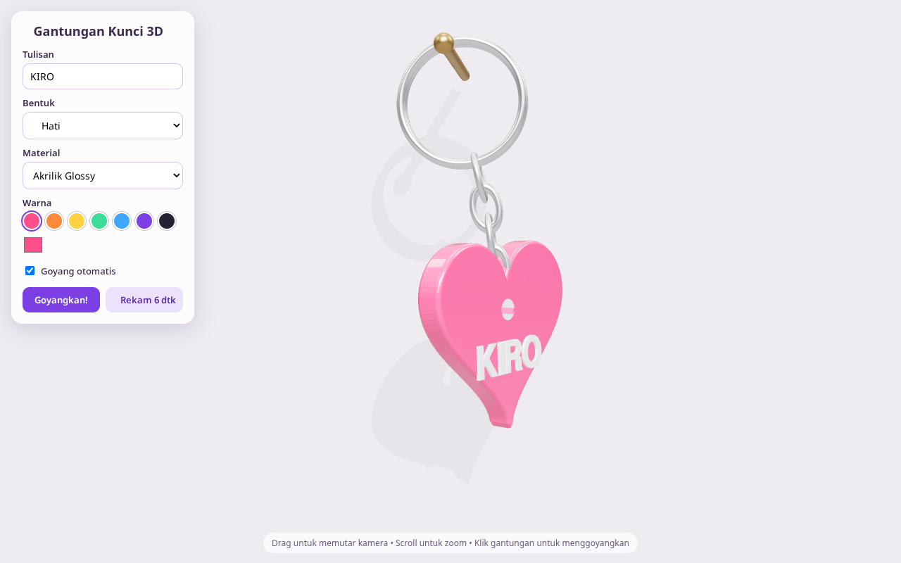
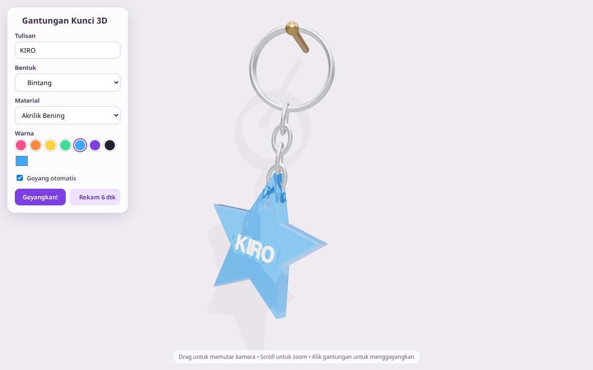
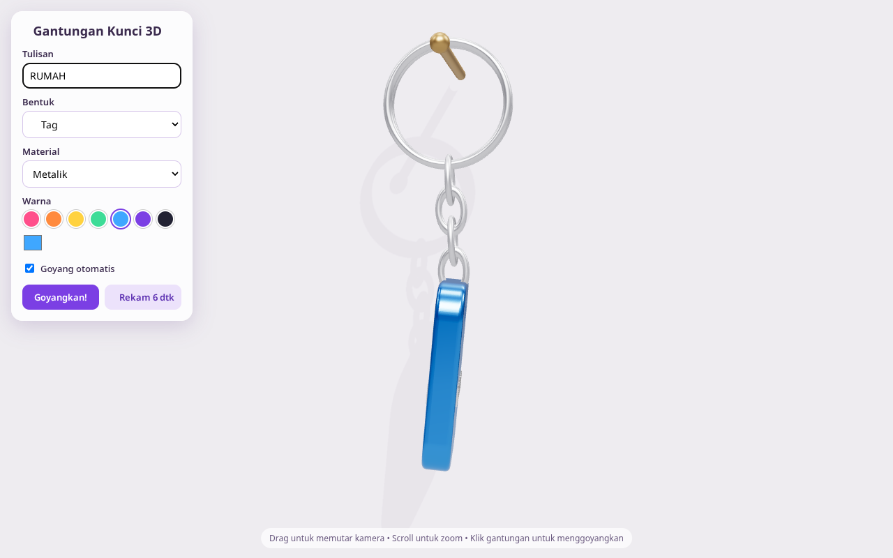
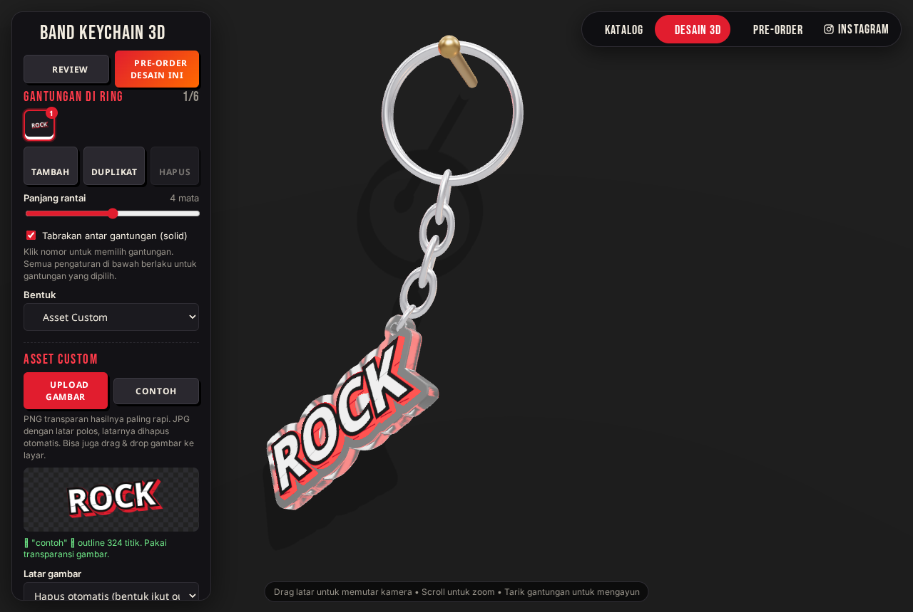
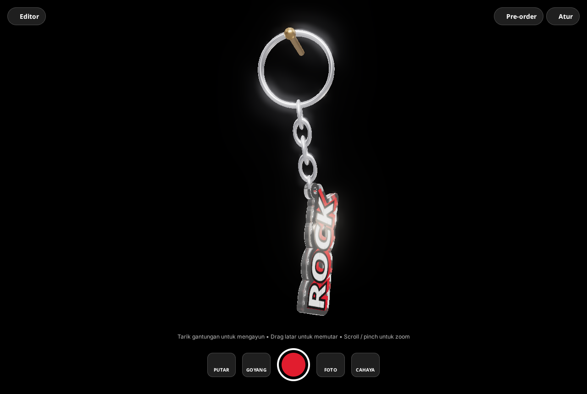

# 🔑 Gantungan Kunci 3D

Animasi 3D gantungan kunci interaktif yang dibuat dengan [Three.js](https://threejs.org/). Semuanya ada dalam satu file HTML, jadi tidak perlu build atau install apa pun.

| Hati – Akrilik Glossy | Bintang – Akrilik Bening | Tag – Metalik |
|---|---|---|
|  |  |  |

## Fitur
- Rantai yang berayun dengan fisika pendulum sederhana, plus bandul yang ikut berputar
- Goyang otomatis, tombol **Goyangkan!**, atau klik langsung gantungannya
- Tulisan custom yang timbul di kedua sisi bandul
- 4 bentuk: Hati, Bintang, Tag, Bulat
- 4 material: Akrilik Glossy, Akrilik Bening, Metalik, Doff
- Pilihan warna siap pakai dan color picker
- **Ukuran asli (mm)** dan **ketebalan akrilik (1–15 mm)**. Tebal di preview 3D proporsional dengan ukuran aslinya.
- Kamera bisa diputar (drag) dan di-zoom (scroll)

### Asset custom


Upload (atau drag & drop) logo/artwork kamu, lalu bentuk akriliknya otomatis **mengikuti outline gambar**:
- PNG/WebP/SVG transparan memakai alpha gambar. JPG berlatar polos, latarnya dihapus otomatis (toleransi bisa diatur).
- **Border akrilik** di sekeliling artwork bisa diatur tebalnya.
- **Lubang gantungan** otomatis di titik paling atas, dan posisinya bisa digeser.
- Artwork dicetak di kedua sisi. Bagian dalam yang bolong otomatis diisi supaya akriliknya solid.
- Opsi **miring sesuai titik berat**: bandul menggantung miring seperti aslinya kalau lubangnya tidak di tengah.

### Gaya Chrome + Emas (studio)
- Material **Chrome + Emas Timbul**: badan chrome, dan bagian artwork yang dipilih (terang, gelap, atau semua) jadi timbul emas
- **Latar Studio**: background hitam, rim light, dan efek glow (bloom)
- Tombol **✨ Preset Chrome + Emas** untuk mengaktifkan semuanya sekaligus

### Halaman Review


Klik **🎬 Buka Halaman Review** (atau buka `index.html#review`). Hasilnya tampilan layar penuh tanpa panel editor:
- **Tarik gantungan** untuk mengayun, **drag latar** untuk memutar kamera, scroll/pinch untuk zoom
- 🔄 Putar otomatis 360°, 💨 Goyang, 🌗 Ganti latar (studio/terang), 📸 Foto PNG
- ⏺ **Rekam bebas**: tekan untuk mulai dan tekan lagi untuk berhenti (maks. 60 detik). Video langsung terunduh sebagai `.webm`
- Shortcut: `Spasi` untuk rekam/stop, `Esc` untuk kembali ke editor

### Export
- 🧊 **Model 3D `.glb`**: bisa dibuka di Blender, viewer 3D, atau dipakai di web/AR
- 📸 **Gambar `.png`**: screenshot tampilan saat ini
- ✂️ **Cut line `.svg`**: garis potong merah (outline + lubang) dan artwork dalam ukuran mm, siap dikirim ke vendor akrilik
- 🎥 **Video `.webm`**: rekam animasi 6 detik

## Cara menjalankan
Buka `index.html` di browser modern (Chrome, Edge, Firefox, Safari). Perlu koneksi internet karena Three.js dimuat dari CDN.

Bisa juga lewat server lokal:

```bash
python3 -m http.server 8000
# lalu buka http://localhost:8000
```

Atau aktifkan **GitHub Pages** (Settings → Pages → Deploy from branch `main`, folder `/root`) supaya bisa diakses online di `https://ridho-fauzan.github.io/GantunganKunci3d/`.
