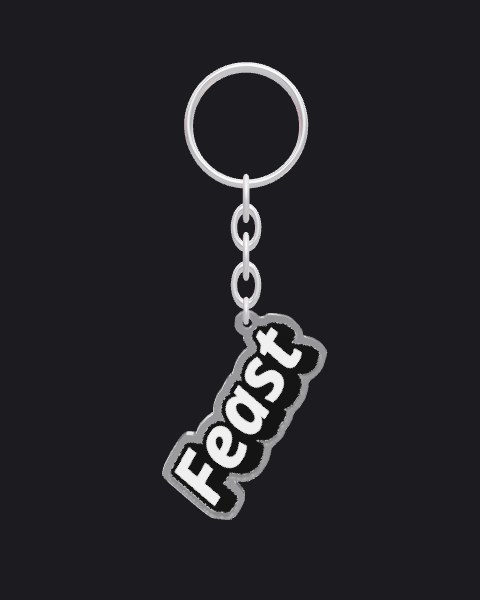
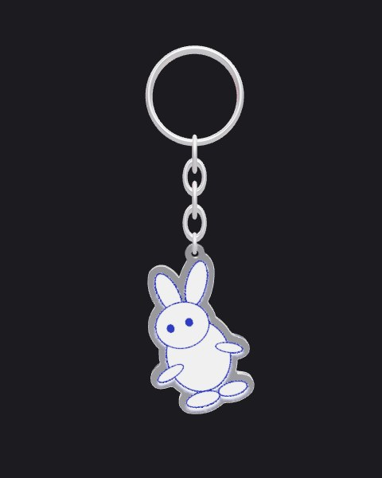
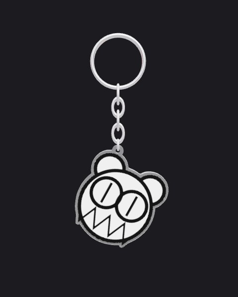
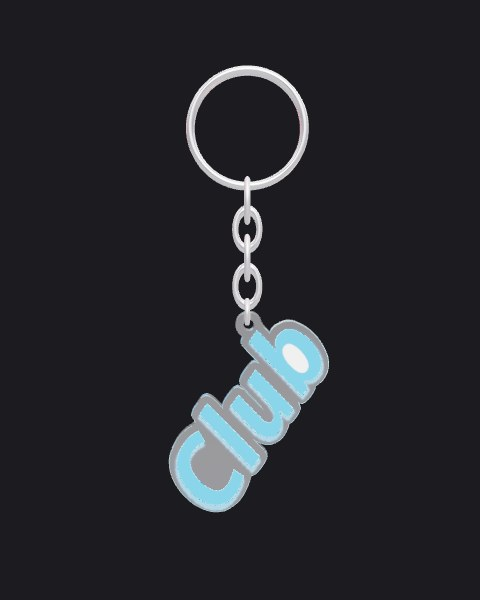
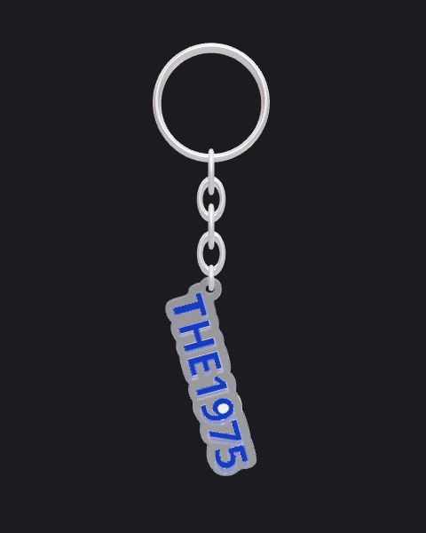
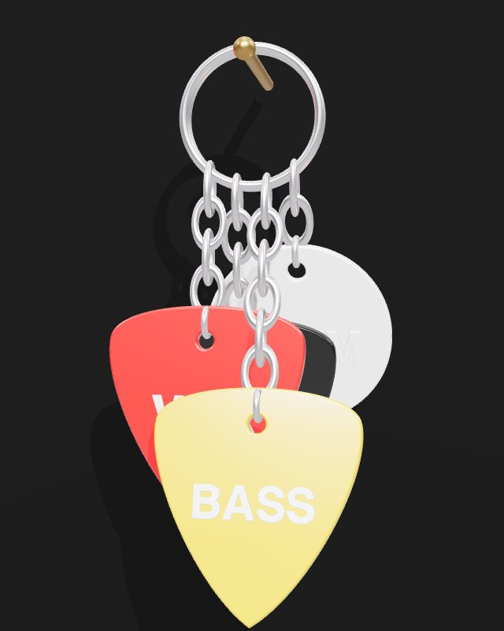
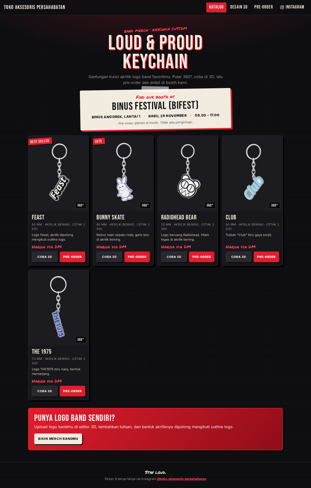

# Band Keychain 3D

Web merch band untuk **Toko Aksesoris Persahabatan**: preview 3D gantungan kunci interaktif ([Three.js](https://threejs.org/)), katalog, dan form pre-order. Tema gelap ala poster band (merah, hitam, krem). Website statis, tidak perlu build atau install apa pun.

| Feast | Bunny Skate | Radiohead Bear | Club | The 1975 |
|---|---|---|---|---|
|  |  |  |  |  |

## Fitur
- Rantai yang berayun dengan fisika pendulum sederhana, plus bandul yang ikut berputar
- Goyang otomatis, tombol **Goyangkan!**, atau klik langsung gantungannya
- Tulisan custom yang timbul di kedua sisi bandul
- 5 bentuk: **Pick Gitar**, Hati, Bintang, Tag, Bulat
- 3 material: Akrilik Glossy, Akrilik Bening, Doff
- Pilihan warna siap pakai dan color picker
- **Ukuran asli (mm)** dan **ketebalan akrilik (1–15 mm)**. Tebal di preview 3D proporsional dengan ukuran aslinya.
- Kamera bisa diputar (drag) dan di-zoom (scroll)

### Asset custom
- Tulisan tetap bisa ditambahkan di atas artwork (ukuran, posisi atas/tengah/bawah, warna).


Upload (atau drag & drop) logo/artwork kamu, lalu bentuk akriliknya otomatis **mengikuti outline gambar**:
- PNG/WebP/SVG transparan memakai alpha gambar. JPG berlatar polos, latarnya dihapus otomatis (toleransi bisa diatur).
- **Latar gambar → Pertahankan latar**: background gambar tidak dihapus, jadi akriliknya berbentuk persegi mengikuti gambar (cocok untuk foto atau ilustrasi full).
- **Border akrilik** di sekeliling artwork bisa diatur tebalnya.
- **Lubang gantungan** otomatis di titik paling atas, dan posisinya bisa digeser.
- Artwork dicetak di kedua sisi. Bagian dalam yang bolong otomatis diisi supaya akriliknya solid.
- Opsi **miring sesuai titik berat**: bandul menggantung miring seperti aslinya kalau lubangnya tidak di tengah.

### Stack: banyak gantungan di satu ring


- Bagian **Gantungan di ring** (paling atas panel): **Tambah**, **⧉ Duplikat**, **Hapus**, maksimal 6 gantungan
- Klik nomor untuk memilih gantungan. Semua pengaturan (bentuk, tulisan, asset custom, material, warna, ukuran, ketebalan) berlaku untuk gantungan yang dipilih saja
- **Panjang rantai** (0–8 mata) per gantungan, supaya posisinya bisa dibuat bertingkat
- Gantungan disebar di sepanjang ring, berselang depan/belakang, dan semuanya ikut berayun
- **Tabrakan antar gantungan (solid)**: tiap akrilik diperlakukan sebagai pelat padat (outline + ketebalan aslinya), jadi gantungan saling menahan dan memantul sedikit, tidak saling tembus. Bisa dimatikan lewat checkbox kalau perangkat terasa berat.
- Export GLB berisi seluruh stack. Export SVG cut line berisi gantungan yang sedang dipilih (satu potongan akrilik)

### Halaman Review


Klik **Buka Halaman Review** (atau buka `desain.html#review`). Hasilnya tampilan layar penuh tanpa panel editor:
- **Tarik gantungan** untuk mengayun, **drag latar** untuk memutar kamera, scroll/pinch untuk zoom
- Putar otomatis 360°, Goyang, Ganti pencahayaan, Foto PNG
- **Rekam bebas**: tekan untuk mulai dan tekan lagi untuk berhenti (maks. 60 detik). Video langsung terunduh sebagai `.webm`
- **Atur**:
  - **Pencahayaan & pantulan**: Terang, Studio Hitam + Glow, atau 7 gaya cahaya HDRI ([Poly Haven](https://polyhaven.com/hdris), CC0): Studio Foto, Neon, Sunset, Langit Cerah, Hutan, Malam Kota, Kota. HDRI hanya dipakai untuk cahaya dan pantulan di chrome/akrilik. **Latarnya tetap polos.**
  - **Warna latar**: Otomatis (ikut gaya cahaya), 7 warna siap pakai, atau color picker. Tombol dan teks UI menyesuaikan latar gelap/terang.
  - Efek glow, tampilkan/sembunyikan paku
  - **Putar 360° otomatis** dengan kecepatan (5–120 detik per putaran) dan arah
  - **Rekam tepat 1 putaran 360°**: video berhenti otomatis setelah satu putaran penuh
- Shortcut: `Spasi` untuk rekam/stop, `Esc` untuk kembali ke editor

### Export
- **Model 3D `.glb`**: bisa dibuka di Blender, viewer 3D, atau dipakai di web/AR
- **Gambar `.png`**: screenshot tampilan saat ini
- **Cut line `.svg`**: garis potong merah (outline + lubang) dan artwork dalam ukuran mm, siap dikirim ke vendor akrilik
- **Video `.webm`**: rekam animasi 6 detik

## Halaman toko
| Halaman | Isi |
|---|---|
| `index.html` | **Katalog (halaman utama)**: produk dengan video preview 360°, info booth Bifest, tombol **Coba 3D** dan **Pre-order** |
| `desain.html` | Editor 3D. `desain.html?produk=<id>` membuka produk katalog. Tombol **Pre-order desain ini** membawa desain ke form pre-order |
| `preorder.html` | Form pre-order + ringkasan, dikirim via DM Instagram (atau WhatsApp). **Tanpa pengiriman**: semua pesanan diambil di booth Bifest |



**Mengatur toko:** edit `assets/shop.js`: nama toko, Instagram, WhatsApp (opsional), info event/booth, dan daftar produk (nama, harga, aset logo, gambar, video, tampilan awal di editor). Harga `null` tampil "Harga via DM".

**Aset produk:** taruh logo di `katalog/aset/<id>.png` (PNG transparan paling rapi, latar putih polos juga bisa).

**Membuat ulang poster + video 360°** (setelah mengganti aset atau menambah produk):
```bash
npm i -D playwright && npx playwright install chromium   # sekali saja
python3 -m http.server 8765                              # di folder repo, biarkan jalan
FFMPEG=ffmpeg node tools/render-katalog.cjs              # semua produk, atau: ... render-katalog.cjs feast,club
```
Hasilnya `katalog/<id>.jpg` (poster), `katalog/<id>.mp4` (H.264, untuk iPhone/Safari) dan `katalog/<id>.webm` (cadangan). Video diputar otomatis tanpa suara hanya saat kartunya terlihat.

## Cara menjalankan
Buka `index.html` (katalog) di browser modern (Chrome, Edge, Firefox, Safari). Perlu koneksi internet karena Three.js dimuat dari CDN.

Bisa juga lewat server lokal:

```bash
python3 -m http.server 8000
# lalu buka http://localhost:8000
```

Atau aktifkan **GitHub Pages** (Settings → Pages → Deploy from branch `main`, folder `/root`) supaya bisa diakses online di `https://ridho-fauzan.github.io/GantunganKunci3d/`.
